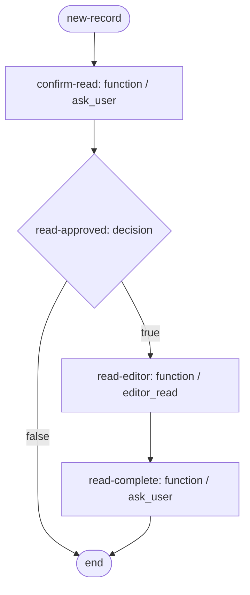

# Data-event integration

## Choose the right trigger

Data events are client-side JavaScript, held together in a form's single
`script` field, not server jobs. Preserve existing handlers and inspect actual
contents of attached/loaded code. No module imports are available in the
ordinary data-event script.

| Event | Use |
| --- | --- |
| `load-record` | Editor opens for a new or existing record. |
| `new-record` | New record, after load. |
| `edit-record` | Existing record opens, after load; not every field change. |
| `change`, with field data name | A field changes, including calculated values. |
| `click`, with field data name | A hyperlink field is tapped. |
| `validate-record` / `validate-repeatable` | Synchronous validation; `INVALID(message)` rejects saving. |
| `save-record` | Immediately before saving, after validation; no asynchronous work. |
| `change-geometry` | User location/geometry changes; guard empty geometry. |

For behavior needed on both new and reopened records, register one shared
handler with `new-record` and `edit-record`. Do not also launch the same work
from `load-record` unintentionally. Repeated launches can replace an active
FLOW. A field rule may need both opening-time initialization and a `change`
handler because defaults and reopening do not fire a field change.

`SETVALUE()` does not itself fire `change`; affected calculated fields can.
A native signature save or clear uses ordinary `change` on that field. Stamp
a signer from that event, not from `edit-record`. Read `STATUS()` before
`SETSTATUS()`; editor tools cannot change built-in status. See the signature
contract in the runtime reference before promising a name, clock, or status
advance.
Do not read `$field_name` immediately after setting it and assume fresh values:
carry local computed values forward. Use field data names for ordinary data-event
functions; verify tools that instead require field keys.

Ordinary `REQUEST()`, `LOADRECORDS()`, and callback-based `LOADFILE()` use
callbacks, not an assumed Promise/async-await contract. Async work cannot block
validation or saving, and `FLOW()` cannot be launched from inside their async
callbacks because `dataEventDepth` has already returned to zero. Do not confuse
these APIs with the separate FLOW JS evaluator. Check signatures, licensing/access,
and organization configuration before designing around reference records or files.

## Lookup before launch

Decide whether the picker needs a complete eligible list or matching search
results. The reference `record_search_tool` searches locally available records
and cannot enumerate them with a blank query. `LOADRECORDS()` is a data-event
operation, not a FLOW node. Do not put `FLOW()` in its callback or silently
swap in search if the user requested a loaded list. If lookup must finish
first, verify a later synchronous data-event trigger in the same editor
session and use only bounded, fresh results scoped to that session. If no such
path is verified, report the limitation and get agreement on an alternative.

## Resume a signed workflow

An existing signature does not replay its `change` handler when the record
reopens. Separate signer stamping on native signature change from deciding
which phase to resume. Use the same phase rule for sign-off transitions and
reopen role selection. Apply it to the current status, the relevant signature,
and any controlling answer, using value shapes verified for each read path.
Do not treat a signature alone, an unknown answer, or a displayed choice label
as proof that all transition conditions are met.

Compute the effective phase synchronously before launching `FLOW()` from
`edit-record` and pass that computed phase to the graph. Preserve explicit
rework and later stages unless the agreed transition says otherwise. Do not
re-stamp an existing signer. If opening the record is approved to repair its
status, call `SETSTATUS()` only for a valid, different status on an allowed
transition. Treat this as an editor change, not a saved record or a read-only
test. Keep pure role selection separate from that optional write.

In an authorized sandbox, test fresh sign-off, reopening an already-signed
record with stale status, missing or negative controlling answers, explicit
rework, and an already-advanced record. Check the first role prompt, editor
status, and save versus cancel separately.

## Other data-event conventions

Use `change-geometry` when work depends on a user-captured location; never assume
a new record already has geometry. Respect repeatable scope and verify its hooks.
Use suitable built-ins, such as `FIELD_NAMES()` for bulk field operations,
rather than hardcoded lists or custom reimplementations.

`STORAGE()` is device-persistent string storage, not per-record memory. If used,
scope keys by form, account where available, record, and editing session; unsaved
records need a session nonce. Serialize values and clean up on verified cancel/
unload hooks. Never place credentials or unnecessarily sensitive data there.

## Suggestion gate

When the user suggests a change without authorizing the exact live write,
state whether it will work on the target and ask once whether to update the
data events or leave them unchanged. Identify unsupported parts and pause the
live-write path. Do not repeat an approval question already answered for the
same target and scope. An explicit request to update now does not waive
freshness verification, or the rehearsal gate for schema, Reference File, and
record changes. It does waive the clone and rehearsal block for an approved
script-only FLOW or data-event update, described below.

## Script-only FLOW updates

Publishing a form script that adds or changes a FLOW, or another data-event
handler, does not create, update, or delete records and does not change stored
field values. The write changes only client behavior. That behavior can be
opted out of: do not start the flow, cancel it, or restore the previous script.
It is not a data migration.

Do not let an authoring MCP tool, including form update, block an approved
script-only update because a sandbox clone, rehearsal form, or record-count
check is unavailable. A missing clone is not a reason to withhold the update.
Record count is informational for this write; a changed count does not by
itself stop it.

This exception is only for a script-field update:

- Obtain approval of the target form and script scope once. Do not ask again
  for the same scope.
- Send the script only. Do not send elements, status fields, choice lists, or
  removed keys.
- Re-read the form immediately before writing and merge into that fresh script.
- After writing, re-read and compare the complete saved script. A truncated
  save is a failed update, not success.
- Do not open or mutate records to test the update.

Schema edits, Reference File replacement, choice or classification changes,
and record writes stay on the full sequence below, including sandbox rehearsal
when that work is production-sensitive.

Author the FLOW so the new behavior stays optional. Do not use `INVALID` or
another save block unless the user explicitly asks for one and the runtime
supports it. Cancelling or never starting the flow must leave the record
saveable.

## Safe live-write sequence

Authoring permission is not deployment permission. If the host provides
Fulcrum app-editing/data-event safety skills, follow them as well; this folder
does not require them to be installed. If their applicable gates are stricter,
do not bypass them for schema, Reference File, or record changes. A stricter
sandbox or MCP clone gate does not apply to an approved script-only FLOW
update, because that write does not change stored data.

1. Confirm account, organization, exact form, environment, production/sandbox
   classification, current script, schema, dependencies, and record count.
   An unfamiliar or empty form is not automatically a safe sandbox.
2. Describe data impact, overwrites, permissions, triggers, runtime side effects,
   known consumers of shared files, and performance risks. Present a readable
   proposed diff preserving unrelated behavior. Obtain explicit approval of the
   target and scope. Provide a rubric-based design assessment when available;
   never invent a numeric score without a defined rubric.
3. For production-sensitive schema, Reference File, or record changes, use an
   authorized sandbox/clone first. Apply and verify the proposed design there,
   present the reviewed clone-to-production diff and evidence, then obtain
   explicit promotion approval. If clone or verification operations are
   unavailable, deliver artifacts only. A script-only FLOW or data-event update
   is not that work. Do not block it on a missing clone. See
   [Script-only FLOW updates](#script-only-flow-updates).
4. Immediately before each live write, re-read its target and dependencies.
   Reconcile approved edits into the fresh full script instead of overwriting
   it with an earlier snapshot. If scope, content, classification, or identity
   changed materially, stop for reconciliation and renewed approval, then
   repeat the fresh read. Recheck record count immediately before writing.
   For schema, Reference File, or record changes, a changed count requires
   reconciliation, not silent continuation. For a script-only FLOW update,
   report a changed count and continue.
5. Use the actual authorized form-update tool/schema, then re-read to verify
   the complete saved script and intended diff. Report partial failure plainly;
   do not blindly retry mutations. Report cloud script verification, execution
   on the target build after syncing the revision, and record persistence as
   separate outcomes. Do not execute record-changing tests against production,
   including opening an existing record if its handler can modify it. After the
   saved script is verified, update the workflow diagram from that script in the
   same change, including any already opened canvas. A small or script-only
   update does not exempt the diagram.

Shared Reference File replacement affects existing consumers immediately.
Inspect full file contents and transitive dependencies; approve the replacement
and composed script together. Fresh-read file/known consumers before upload,
verify uploaded content, then fresh-read and reconcile the form before updating
its script. Do not upload first and ask approval afterward. Warn separately
about transfer/update cost for large or frequently replaced files.

Never bypass an unavailable/authentication-failed connector with private browser
state, extracted tokens, or a device database patch. Stop for authorized access.
An approved read-only export is a drafting alternative, not a deployment bypass.

## Client-side safety

No secrets belong in scripts, Reference Files, URLs, or storage. Credentialed
integrations require authorized server-side mediation, not embedded API keys.
Do not implement permission enforcement with hidden fields or client scripts.
Verify actual platform permissions and invocation context.

Design explicitly for offline behavior; requests need a graceful failure or
agreed online-only requirement. Browser requests also require compatible CORS.
Pin external library versions and inspect their code/dependencies. Do not
silently replace required offline assets with remote resources.

## Example and performance

[The read-only example](../examples/read-editor.js) proposes one `new-record`
handler. Confirm that trigger and required tools before integrating it; do not
deploy it unchanged over an existing script.

The decision default, unhandled tool errors, and prompt cancellation abort the
run; the abort terminal is omitted from the diagram for readability. No success
message is shown after a failed read. The diagram is a proposal, not a deployed
workflow.

**Static assessment:** the example has four nodes, at most two prompts and
one editor read per launch, no retries, external libraries, network requests,
or record writes. Editor snapshot serialization grows with record/form size;
large repeatables/media metadata and repeated launches can increase latency.
Low graph-level complexity; full device performance remains unmeasured and
host-dependent. No live form dependencies were reviewed for this generic example.
Use representative empty and large records to measure it before deployment.
No Reference File upload is part of the example.

## Public references

- [Data events](https://docs.fulcrumapp.com/docs/data-events-reference)
- [Calculations and expressions](https://docs.fulcrumapp.com/docs/calculations-reference)
- [LOADFILE](https://docs.fulcrumapp.com/docs/data-events-loadfile)
- [STORAGE](https://docs.fulcrumapp.com/docs/data-events-storage)
